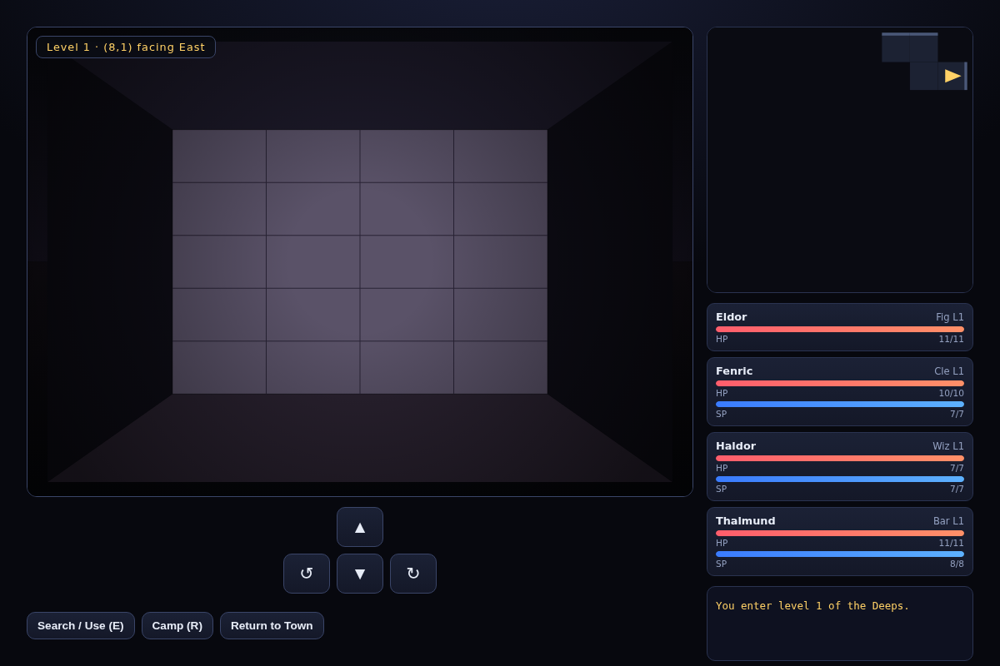

# Deeps of Zar — A Bard's Tale

A modern, browser-based homage to *The Bard's Tale* (1985): a first-person,
grid-based dungeon crawler with a **procedurally generated maze**, **D&D-style
heroes and monsters**, and **turn-based combat**. Pure vanilla JS + Canvas — no
build step, no dependencies, no server required.



## Play

Just open `index.html` in any modern browser:

```bash
# option 1 — open the file directly
xdg-open game/index.html      # Linux
open game/index.html          # macOS

# option 2 — serve it (optional)
cd game && python3 -m http.server 8000
# then visit http://localhost:8000
```

The game uses classic `<script>` tags (not ES modules), so it runs straight
from the `file://` protocol with no local server.

## How to play

1. **Assemble a party** — four D&D heroes are rolled for you (4d6-drop-lowest
   ability scores, racial bonuses, class kit). Reroll any you dislike.
2. **Skara Brae** — the town hub. Visit the **Temple** to heal/revive, **Garth's
   Supplies** to buy gear and potions, the **Guild** to inspect your party, then
   descend into **The Deeps**.
3. **Explore** the maze in first person.

| Action | Keyboard | Touch |
|--------|----------|-------|
| Move forward / back | `W` `S` / `↑` `↓` | ▲ ▼ |
| Turn left / right | `A` `D` / `←` `→` | ↺ ↻ |
| Search / Use / interact | `E` or `Space` | Search / Use |
| Make camp (rest) | `R` | Camp |

4. **Fight** monsters in turn-based combat — Attack, Cast spells, use Items,
   Defend, or Flee. Each hero acts on initiative; win to earn XP and gold.
5. **Descend five levels**, survive traps and fountains, loot chests, then face
   **Mangar the Dark** and reclaim **the Sword of Zar** to win.

Enter a **seed** on the title screen to reproduce the exact same dungeon.

## What's implemented

- **Procedural dungeons** — recursive-backtracker mazes with rooms, braided
  loops, and depth-scaled feature placement (stairs, chests, fountains, traps,
  lore, boss altar). Levels are stitched together via aligned stairs.
- **D&D characters** — 9 classes (Fighter, Paladin, Ranger, Rogue, Bard, Cleric,
  Wizard, Sorcerer…), 8 races, six ability scores with modifiers, AC from armor
  type + DEX, proficiency bonus, XP curve, leveling with HP/SP gains and spell
  unlocks.
- **D&D monsters** — an SRD-inspired bestiary (Goblins → Owlbears → Vampires →
  Mind Flayers) with per-monster HD/AC/attacks, special traits (poison,
  paralysis, life drain, regeneration), depth tiers, and a boss.
- **Turn-based combat** — d20 attack rolls, criticals, damage dice, spell points,
  ~10 spells (Magic Missile, Fireball, Cure Wounds, Bless, Sleep…), status
  effects, monster AI, fleeing, and XP/gold rewards.
- **First-person pseudo-3D** renderer (nested wall frames with fog) plus a
  live **automap**.
- A slick, responsive dark-fantasy UI.

## File layout

```
game/
├── index.html        # markup shell + script includes
├── css/style.css     # all styling
└── js/
    ├── rng.js         # seeded PRNG + dice helpers
    ├── data.js        # races, classes, spells, items, monsters
    ├── character.js   # character generation, derived stats, leveling
    ├── dungeon.js     # procedural maze generation
    ├── combat.js      # turn-based combat engine
    ├── render3d.js    # first-person dungeon renderer
    ├── automap.js     # top-down explored map
    └── game.js        # main controller: screens, town, nav, combat UI
```

Everything is dependency-free and self-contained.
